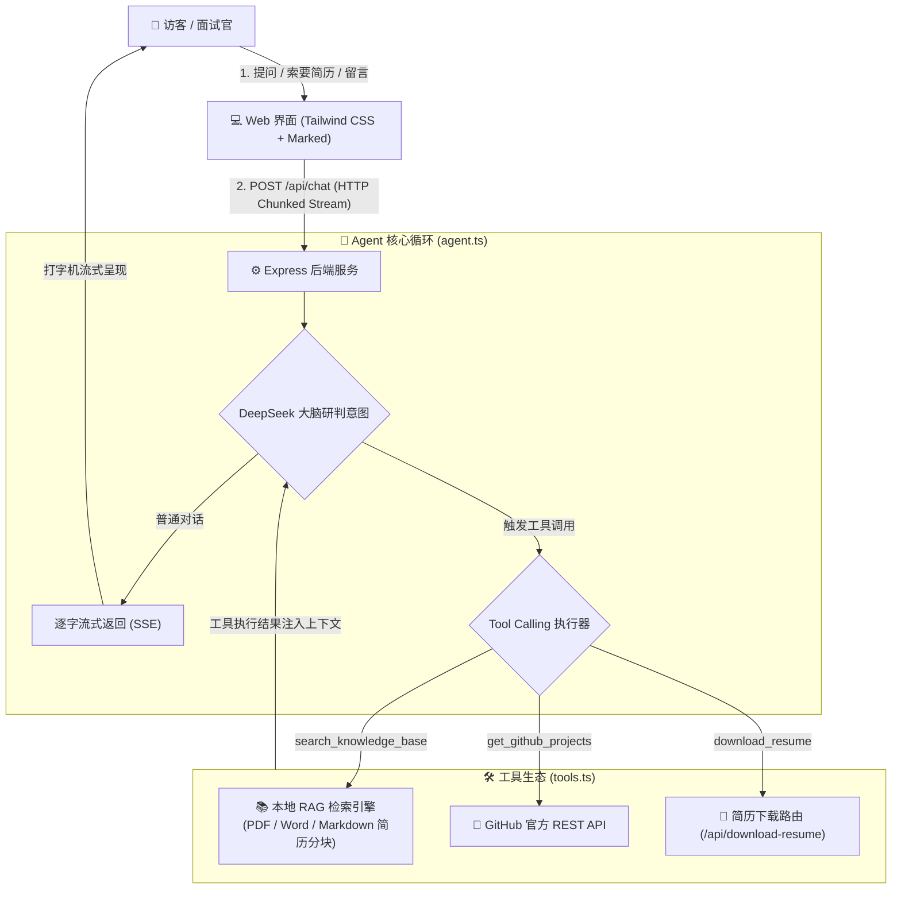

# 🤖 WuQi Avatar Agent (吴琦的个人 AI 数字分身)

<p align="center">
  
  
  
  
</p>

> 基于 **TypeScript + DeepSeek 大模型** 从零打造的个人数字化分身智能体（AI Digital Avatar）。
> 具备 **自主 Tool Calling 工具调度**、**流式打字机响应 (SSE)**、**本地简历 RAG 检索增强** 与 **一键简历分发下载** 全套闭环工程能力。

---

## 🌟 核心特性 (Features)

- 🧠 **大模型自主意图判断与工具调度 (Function / Tool Calling Loop)**：
  - 基于 DeepSeek Function Calling 协议，构建了完整的 ReAct Agent 思考与行动闭环。
  - 模型能根据访客问题，自主决策是直接回答、查阅本地技术文档库、拉取 GitHub 仓库还是提供简历下载。
- ⚡ **打字机级流式渲染 (Streaming SSE)**：
  - 基于 Node.js 异步生成器 (`AsyncGenerator`) 与 HTTP Chunked 传输，首字返回时间低于 300ms，带来丝滑交互体验。
- 📚 **本地简历与技术文档 RAG 增强 (Retrieval-Augmented Generation)**：
  - 原生支持 `.pdf`、`.docx`、`.md` 多格式解析与动态分块索引。
  - 针对中文短语实现 N-Gram 柔性分词匹配，精准还原项目攻关、高并发调优及教育背景等底层细节，彻底杜绝模型幻觉。
- 🐙 **真实 GitHub 开源动态同步**：
  - 动态集成 GitHub 官方 API，实时拉取个人公开仓库、Stars 与技术演进足迹。
- 📄 **一键简历分发下载**：
  - 具备专属 `download_resume` 工具，访客索要时一键下发带有真实凭证的 PDF 简历。

---

## 🏗️ 系统架构图 (Architecture)



---

## 📂 项目结构 (Project Structure)

```text
my-avatar-agent/
├── docs/                       # 个人知识库 (PDF简历、Word文档、项目复盘Markdown)
│   ├── 吴琦 全栈开发.pdf
│   └── resume_details.md
├── public/                     # 现代化前端界面
│   └── index.html
├── src/
│   ├── agent.ts                # Agent 核心逻辑 (会话记忆、工具循环、流式生成器)
│   ├── costGuard.ts            # 预算熔断与 Token 统计护栏
│   ├── profile.ts              # 个人档案、人设与安全边界 Prompt
│   ├── rag.ts                  # 本地多格式文档分块与中文检索器
│   ├── server.ts               # Web 服务与 API 路由
│   └── tools.ts                # 工具定义 (GitHub、RAG、简历下载)
├── .env.example                # 环境变量配置模板
├── package.json
└── tsconfig.json
```

---

## 🚀 快速启动 (Quick Start)

### 1. 克隆项目与安装依赖

```bash
git clone https://github.com/2454435987/my-avatar-agent.git
cd my-avatar-agent
npm install
```

### 2. 配置环境变量

复制 `.env.example` 并重命名为 `.env`：

```bash
cp .env.example .env
```

在 `.env` 中填入你的密钥：

```env
DEEPSEEK_BASE_URL="https://api.deepseek.com"
DEEPSEEK_API_KEY="sk-你的DeepSeek_API_Key"
DEEPSEEK_MODEL="deepseek-chat"
GITHUB_USERNAME="2454435987"

# 可选：微信推送与邮箱通知
PUSHPLUS_TOKEN="你的PushPlus_Token"
EMAIL_USER="your-qq@qq.com"
EMAIL_PASS="你的16位QQ邮箱授权码"
```

### 3. 放置你的个人资料

把你的真实简历（支持 `.pdf`、`.docx`、`.md`）直接放置在 `docs/` 目录下即可，系统会在启动时自动建立索引。

### 4. 运行服务

```bash
# 开发环境（支持热重载）
npm run dev

# 生产运行
npm run web
```

打开浏览器访问：`http://localhost:3000` 即可开始与 AI 分身对话！

---

## 🛠️ 技术选型 (Tech Stack)

| 模块 | 技术选型 | 说明 |
| :--- | :--- | :--- |
| **编程语言** | TypeScript (ESNext) | 强类型约束，提升工程可维护性 |
| **底层大模型** | DeepSeek-V3 (`deepseek-chat`) | 高性价比、强大的逻辑推理与 Function Calling |
| **运行时** | Node.js 20+ / tsx | 原生支持 ESM，快速编译执行 |
| **Web 框架** | Express / CORS | 轻量高效 HTTP 服务，原生支持 Transfer-Encoding 流 |
| **文档解析 (RAG)**| `pdf-parse` + `mammoth` | 纯本地无依赖解析 PDF 与 Word |
| **即时通讯推送** | PushPlus API + `nodemailer` | 微信公众号毫秒级图文卡片 + SMTP 465 SSL 邮件 |
| **UI 呈现** | Tailwind CSS + Marked.js | 现代科技感暗黑界面 + 动态 Markdown 渲染 |

---

## 👤 关于作者

- **姓名**：吴琦
- **方向**：全栈开发 / 软件工程师
- **GitHub**：[@2454435987](https://github.com/2454435987)
- **教育背景**：湖北工业大学工程技术学院 - 计算机科学与技术
